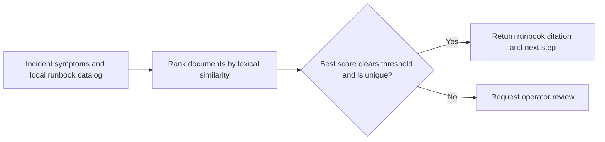

# On-call Runbook Retriever

An offline Python lab for on-call responders. It ranks synthetic runbooks with TF-IDF cosine similarity, cites a matching runbook, and asks for review when the match is weak or tied.

## Quick start

Run `python3 retrieve.py "kafka consumer lag"` from the repository. The sample returns `KAFKA-01`. Try `python3 retrieve.py "printer toner"` to see the review decision.

## Scope

The lab uses two synthetic runbooks. It makes no external calls. The similarity threshold has no production calibration.

## Local verification

Run `make verify` with Make and Python 3 installed. The target runs the documented sample through the project CLI. It also runs the existing Python unit tests.

## Business problem

Responders need a cited runbook for incident symptoms and an explicit review outcome when the local catalog provides weak evidence.

## Project walkthrough



[Architecture and data flow](docs/ARCHITECTURE.md) · [Business problem, demo, and verification](docs/CASE_STUDY.md)

## Run the project

### Local setup

Run `make verify` with Python 3 and Make installed.

### CLI usage

```sh
python3 retrieve.py 'kafka consumer lag'
```

### Replay usage

Run `make replay` to replay the checked-in inputs. The runner compares stdout with the baseline, reports differences, and exits nonzero on regression.

[Replay cases](examples/replay-manifest.json) · [Generated report](reports/replay.md) · [Rule implementation](docs/RULES.md)

### Run tests

[Verification report](reports/verification.md) · [Business problem, sample behavior, and limitations](docs/CASE_STUDY.md)


### Limitations

The verification report covers the bundled local examples. See the [case study](docs/CASE_STUDY.md) for project-specific assumptions and operating limits.

## Development and security

See the [developer setup, tool roles, and security checks](docs/DEVELOPMENT.md).

[Local check results](reports/devsecops.md)

## Runbook

[Run, verify, and troubleshoot this project](docs/RUNBOOK.md)
