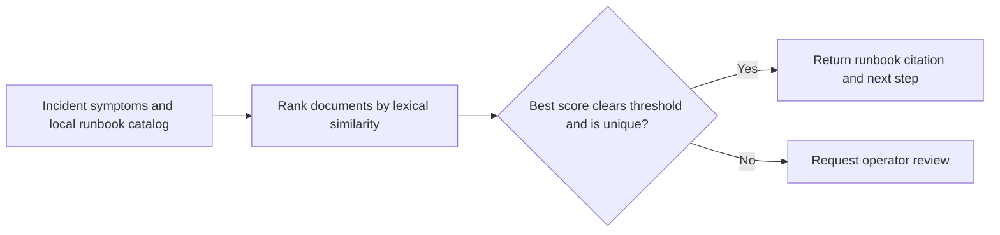

# On-call Runbook Retriever

Responders need a cited runbook for incident symptoms and an explicit review outcome when the local catalog provides weak evidence.

## What I built

I built a local retriever that tokenizes incident symptoms and ranks a small runbook catalog using TF-IDF and cosine similarity. A unique match above the threshold returns a citation and next step. Weak or tied matches go to review.

## How it works



[Architecture](docs/ARCHITECTURE.md) · [Decision rules and source](docs/RULES.md)

## Tools used

| Tool | Role in this repository |
| --- | --- |
| Python | [retrieve.py](retrieve.py) implements the CLI and decision rules. Uses `argparse` to parse command-line options, `collections` to group or count records, `json` to read or write structured records, `math` to compute numeric estimates, `pathlib` to read local files, `re` to match text patterns. |
| Make | Runs the documented example and the local `unittest` suite. |
| Python replay runner | Compares actual stdout with the checked-in baseline fixtures. |
| Ruff and Bandit | Developer lint and static security checks through `make check`. |

## Run the project

Use Python 3.10+ and Make. From the repository root:

```sh
python3 retrieve.py 'kafka consumer lag'
```

The Kafka lag query cites KAFKA-01. The unrelated printer query goes to operator review. [Full expected output](examples/Demo%201.stdout.txt)

### Additional replay cases

- **Weak match** · `python3 retrieve.py 'printer toner'` · [Expected output](examples/Weak%20match.stdout.txt)

## Verify the project

```sh
make verify
make replay
```

`make replay` checks the recorded cases and exits nonzero if the output changes.
See the [developer guide](docs/DEVELOPMENT.md) for the pinned lint and security tools.

## Operating limits

The catalog has two synthetic entries. The threshold has no production calibration, and the tool makes no external calls.

[Case study](docs/CASE_STUDY.md) · [Operator runbook](docs/RUNBOOK.md) · [Verification report](reports/verification.md)
