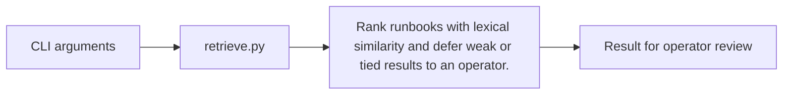

# On Call Runbook Retriever architecture

An offline Python lab for on-call responders. It ranks synthetic runbooks with TF-IDF cosine similarity, cites a matching runbook, and asks for review when the match is weak or tied.

## Operational boundaries

The documented run evaluates the bundled sample locally. Results depend on the quality and scope of the input. The demo makes no live infrastructure changes.
